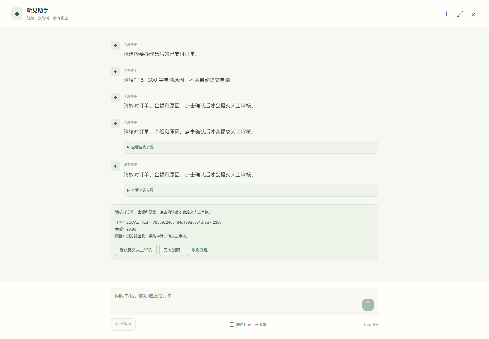
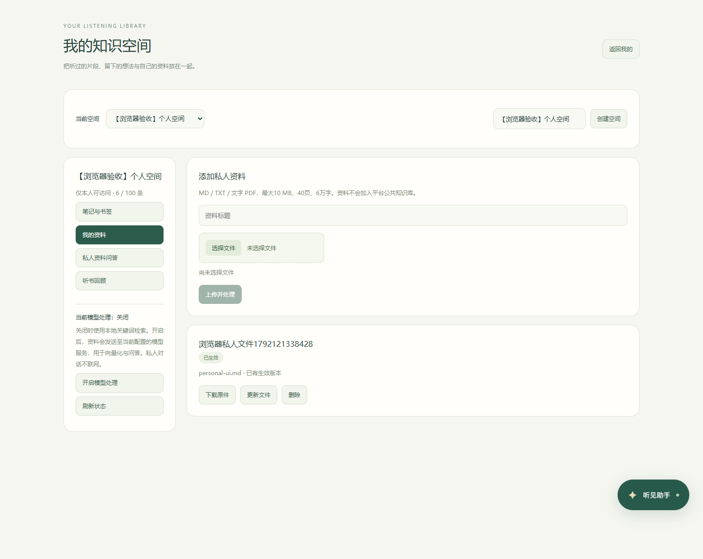
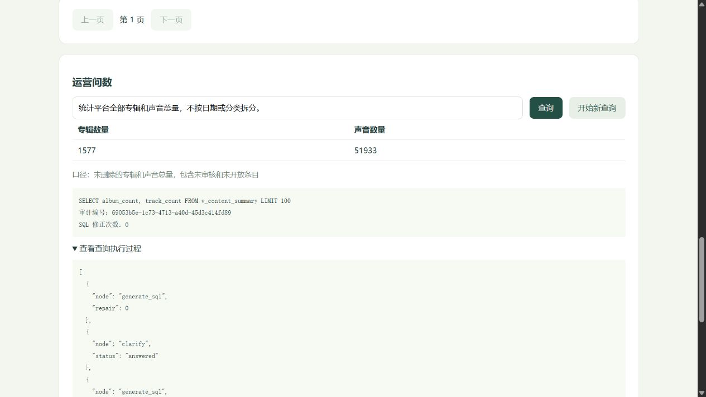
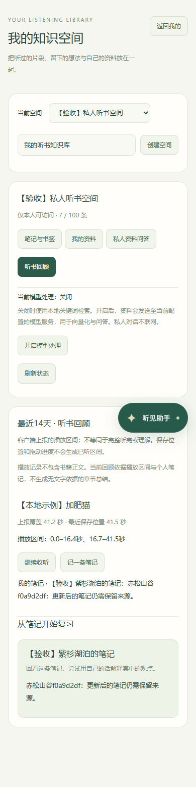
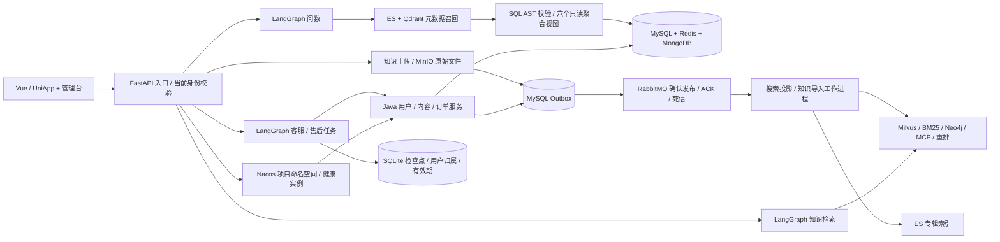

# 听见 · 智能听书与 AI 业务助理

[](https://github.com/GooChen55/tingjian-langgraph/actions/workflows/ci.yml)


Java 17 / Spring Boot · Vue 3 / UniApp · FastAPI · LangGraph · RAG · NL2SQL

围绕听书业务，把个人业务查询、知识库管理、售后办理和运营问数连成可运行的全栈项目。Java 决定身份权限和业务事务；Python 管理对话与检索流程；页面内助手支持小窗、全屏、任务卡片和节点进度。

本版在已有工程基础上整合与改造，保留来源及授权说明。**这是用于学习、演示和求职的本地融合版，真实微信支付、腾讯云点播和数字人由项目维护者后续配置，不作为本轮已验收能力。**

[融合能力映射](docs/融合设计与能力映射.md) · [启动与验收](docs/部署与验收.md) · [面试提纲](docs/求职项目提纲.md) · [外部服务开通](docs/外部服务开通与配置.md) · [来源说明](docs/来源与第三方说明.md)

首次在开发工具中运行，请看 [IDEA / PyCharm 启动与调试指南](docs/README-IDEA-PyCharm.md)，包含启动类、环境文件、运行配置、前端构建与排错。

## 工程亮点

- **有事务边界的业务 Agent**：LangGraph 保存槽位与检查点，售后流程绑定当前账号，通过页面确认卡提交；Java 校验身份、权限和订单状态。
- **可追踪的异步索引**：业务变更与 Outbox 同事务保存，RabbitMQ 确认发布、手动 ACK、租约重试与死信，支持追踪 MySQL 到 Elasticsearch 的投影状态。
- **带隔离与引用的知识检索**：平台资料采用多路召回与重排；私人资料在 TopK 前约束用户、空间和有效版本，模型处理默认关闭，播放回顾基于实际记录。
- **受约束的运营问数**：字段、指标和枚举值三路召回，SQL AST 校验、独立只读账号与六个聚合视图共同限制执行范围，失败修正次数有上限。

## 页面预览

| 页面内助手 | 个人知识空间 |
| --- | --- |
|  |  |

| 运营问数 | 移动端听书回顾 |
| --- | --- |
|  |  |

## 个人知识空间（2026-10-16 新增）

普通用户可创建私人空间，记录带声音时间点的笔记/书签、上传自己的资料，在页面内助手选择私人范围，并根据真实上报的播放区间与笔记查看听书回顾。模型处理默认关闭；对象存储、解析和向量服务均保留替换接口，后续可接入云服务。

[使用与云接入设计](docs/个人知识空间与云服务接入.md) · [新增验收](docs/个人知识空间验收.md)

## 能演示什么

| 场景 | 完整操作链路 |
| --- | --- |
| 听书 | 浏览分类、ES 搜索/建议/排序/筛选、查看章节、播放本地样例、保存与恢复进度 |
| 个人助手 | 查询当前账号的进度、会员、订单及售后；事实由 Java 返回，不由模型猜测 |
| 售后办理 | 选择本人已支付订单 → 补充原因 → 核对草稿 → 点击确认 → 人工审核；可暂停、恢复与取消 |
| 个人知识空间 | 本人空间、笔记/时间书签、私人资料、带来源检索、播放区间回顾；与平台资料分开 |
| 平台知识库管理 | 管理台上传 MD/TXT/文字 PDF → MinIO 原件 → Outbox/RabbitMQ → LangGraph 解析/分块/标签/向量/发布 → 问答引用；支持更新、删除与失败重试 |
| 书籍资料问答 | 上下文改写、指代澄清、向量/BM25、HyDE、图谱及按需联网检索 → RRF → 重排 → 原文证据校验 |
| 运营问数 | 关键词提取 → 字段/指标/枚举值三路召回 → 目录过滤 → SQL 生成、校验、有限修正与只读执行；澄清可重启续接 |
| 内容管理 | 修改专辑标题/公开状态，同事务登记 Outbox，经 RabbitMQ 更新 ES；查询同步状态 |
| 模拟交易 | 服务端定价、幂等下单、超时关单、签名回调、售后审核、退款租约与重试、响应丢失后的恢复 |

## 系统结构



保留三个实际运行的 Java 服务，使用一个 BFF 统一前端入口。原工程按部署单元拆出的账户、搜索、支付、调度等能力，按本版业务归属整合；**没有把原十几个服务全部启动，也没有把配置文件数量当作完成度。** 具体采用、替代及延后项见能力映射。

## 中间件承担的实际工作

| 组件 | 本版用途 |
| --- | --- |
| MySQL | 用户/RBAC、专辑/订单/售后、模拟交易、Outbox、知识资料版本与导入审计 |
| Redis | 登录会话、登录尝试计数；ACL 账号只允许本项目键前缀 |
| RabbitMQ | 专辑索引同步与知识导入两条独立队列；发布确认、持久化、手动 ACK、租约、三次尝试与死信 |
| Nacos | 三个 Java 服务的配置与注册；BFF 只选择本命名空间、组和归属标记匹配的实例 |
| Elasticsearch | 专辑全文搜索、建议、排序、筛选及问数枚举值/元数据检索 |
| MongoDB | 统一听书进度集合与复合索引；知识对话上下文有独立 TTL，长期听书进度不设置 TTL |
| MinIO | 本项目上传资料原件与解析结果；版本化对象存储 |
| Milvus | 知识片段向量召回；按模型、维度和语料版本划分集合 |
| Qdrant | 指标与字段语义召回，不能扩大 SQL 白名单 |
| Neo4j | 来自资料的书籍—章节—片段关系，不把模型推测当作图谱事实 |
| SQLite | 向量缓存、有限对话记录、问数/售后检查点与本机任务归属 |

## 运行

**首次克隆不会带入本机账号、模型密钥、IDE 私有配置或运行数据。** 先按 [首次初始化](docs/部署与验收.md#新目录与首次初始化) 准备 Python、JDK、Maven、Node 和中间件，再启动；不要在刚克隆时使用 `-SkipBuild`。基础 `local` 模式与完整 `vm` 模式的能力不同，完整个人知识空间与异步融合链路需要后者。

```powershell
git clone https://github.com/GooChen55/tingjian-langgraph.git
cd tingjian-langgraph
python -m venv .venv
.\.venv\Scripts\python.exe -m pip install -r requirements/requirements.lock.txt
npm.cmd --prefix frontend/uniapp ci
# 接下来按部署文档初始化所选模式的中间件，再构建启动。
```

当前开发环境：Windows 本机运行应用，`192.168.6.100` 运行隔离的中间件。已初始化的工作目录可直接运行：

```powershell
.\Start.ps1 -Infrastructure vm -SkipBuild -UseLlm -WithKnowledge -WithOperations
```

`-SkipBuild` 仅在源码与构建产物一致时使用。修改 Java 或前端后先停止，再不带此参数构建启动。默认 `auto` 读取上次保存的运行环境；首次克隆可显式选择 `local` 或按部署文档初始化 `vm`。

| 入口 | 地址 |
| --- | --- |
| 听书用户端 | http://127.0.0.1:29183/listen/ |
| 管理台 | http://127.0.0.1:29183/admin |
| 助手工作台 | http://127.0.0.1:29183/ |

初始管理员账号 `admin`，密码位于被 Git 忽略的 `.runtime/admin-password`。模型在管理台配置；API Key 使用 Windows DPAPI 加密，不回显。新电脑或 Windows 用户需重新填写模型密钥。

## 验收与演示边界

本轮融合验收跨 **2026-10-15 至 2026-10-16**。实际结果、命令与证明范围集中记录在 [融合验收记录](docs/融合验收记录.md)，不把原版结果当作新版本结果，不宣称通用模型准确率或生产吞吐。

初始化数据约 1,577 个专辑、51,933 个声音，仅表示示例记录规模。可靠播放样例为两个本地 MP3，不代表全部条目具备有效音源。文字 PDF 支持提取；扫描 PDF 会明确提示需要 OCR，不会伪装导入成功。联网结果引用搜索摘要，不能当作全文阅读。

模拟支付退款明确标记 `LOCAL_SIMULATOR`，不产生真实资金、不授予付费播放权益。外部云服务、生产身份治理、微信/App 真机、直播等原工程扩展不列入本地验收。工程基础、个人改造与第三方归属见来源说明。

## 面试演示建议

1. 播放样例音频，保存进度，在页面内助手查询同一账号的真实进度。
2. 上传一份自建资料，展示导入节点和引用；更新、删除后验证检索变化。
3. 助手选订单、填写原因，刷新页面后恢复，说明为什么自然语言“确认”不能触发提交。
4. 管理台问数，展示三路元数据召回、SQL、口径、只读权限与澄清恢复。
5. 修改专辑，展示 Outbox、消息队列与 ES 投影；补充失败重试和死信负例。

重点讲清权限、事务、图状态、恢复与验证证据；面试前按提纲独立复现，不把框架数量当作项目亮点。

## 验证与公开版本

已有本地验收记录包括 **143 项 Python 测试、42 项 Java 测试、36 项个人知识空间联调检查与 13 项个人空间浏览器检查**，具体日期、证明范围和报告摘要见 [融合验收](docs/融合验收记录.md) 与 [个人空间验收](docs/个人知识空间验收.md)。这些是固定测试场景的结果，不代表模型通用准确率或生产负载能力；GitHub Actions 状态以徽章和实际运行记录为准。

公开仓库不包含 `.runtime`、私有模型配置或个人资料；历史用户、交易和操作日志数据未作为公开初始化内容发布。原城市数据的受限文件由独立编写的虚构演示数据替代。第三方源码保留已有声明，本仓库未给第三方内容追加统一 MIT 授权，详见 [NOTICE](NOTICE.md) 与 [来源说明](docs/来源与第三方说明.md)。
