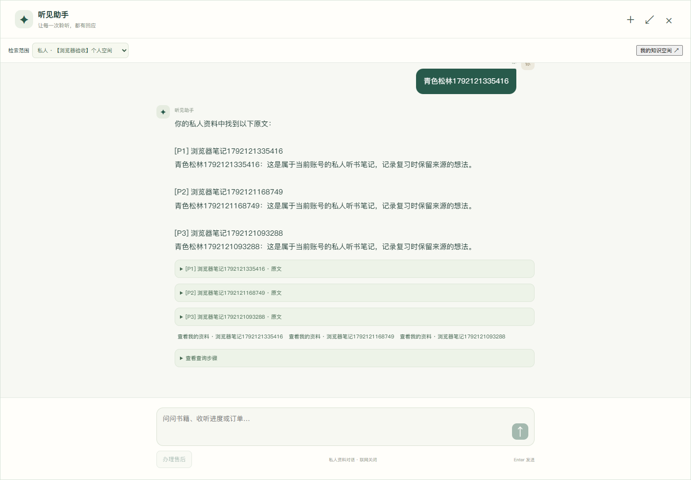

# 个人知识空间验收

日期：2026-10-16。范围为当前 LangGraph 优化版本的个人知识空间与听书回顾，沿用本项目专属中间件。本页记录实际结果，不宣称已接入新的托管云知识库。

| 验收 | 结果 | 实际范围 |
| --- | --- | --- |
| Python 单测 | 143 项通过 | 原有133项与新增10项；归属过滤、对象越界、会话范围、进度跳转、删除后证据复查、未配置云适配器拒绝、local/VM身份隔离、丢失提交响应时保留原件 |
| 个人接口联调 | 35项通过 | 两用户、同用户多空间、笔记/文件/书签、更新失败保留旧版、下载/删除权限、私人关键词检索、真实授权向量/模型检索、SSE、回顾与连续区间 |
| 实际重启恢复 | 1项通过 | 停止并重启本项目应用后，原私人会话与资料引用继续可用；与上项合计36项实际检查 |
| 个人页面操作 | 13项通过 | 创建空间、笔记保存、私人检索、助手范围/禁联网、文件下载删除、真实音频播放上报、播放器时间书签、回顾、切换账号清理与无脚本错误 |
| 既有页面回归 | 通过 | 原管理台上传删除、全屏助手、联网选项、售后任务刷新/暂停/恢复/确认 |
| H5 构建与依赖 | 通过 | 当前前端生产构建、Python pip check |
| VM隔离 | 通过 | 17个其他项目容器与已有重启后检查点的ID、镜像和状态一致 |

这些是契约和功能检查，有重叠，不能将各表行相加当作独立用例总数，也不代表通用检索准确率、学习效果或高并发性能。Java源码本轮未改动，沿用上轮42项单测；新增联调实际使用了Java认证与可播放内容接口。

## 关键负例

- 未登录401；向创建空间、笔记等结构化请求伪造 owner 被拒绝。
- 用户乙不能列出、检索、编辑、删除、重试或下载用户甲的资料。
- 同一用户也不能拿另一个空间的地址修改或下载当前空间资料。
- 未授权模型时只做本地关键词检索；授权测试使用自建验收文本，真实调用当前配置的向量和对话模型，并从独立 Milvus 集合召回。
- 私人对话不能切成平台对话沿用同一会话，不能开启联网搜索；平台知识库管理权限仍只属于管理员。
- 相同播放区间重放不重复计数；序号相同而内容不同返回409；跨度过大或时长不匹配返回422；迟到区间不会覆盖最新保存位置。
- 区间0–8秒与6–12秒合并覆盖为12秒，不把拖动位置算成已听；回顾明确标注客户端上报，不证明实际理解或完整听完。
- 文件更新解析失败时保留旧生效版本；新查询会再次核对删除状态与版本。删除会阻止新检索与下载，历史对话和旧存储暂留。

## 证据与命令

脱敏报告清单见 [personal-20261016.json](acceptance/personal-20261016.json)，保留本地报告位置、实际修改时间和SHA-256。原始账号、口令、会话及日志位于被忽略的 `.runtime`，不随源码公开。

```powershell
.\.venv\Scripts\python.exe -m pytest tests -q
. .\scripts\dev\VmEnvironment.ps1
Set-TaskVmEnvironment $PWD.Path
.\.venv\Scripts\python.exe scripts/verify/VerifyPersonalKnowledge.py
node scripts/verify/VerifyPersonalBrowser.cjs
.\Stop.ps1
.\Start.ps1 -Infrastructure vm -SkipBuild -UseLlm -WithKnowledge -WithOperations
.\.venv\Scripts\python.exe scripts/verify/VerifyPersonalKnowledge.py --verify-restart
.\.venv\Scripts\python.exe scripts/verify/VerifyVmIsolation.py
```

接口脚本会创建独立的验收账号与资料，开启模型的测试会产生少量供应商用量，完成后关闭该验收空间的模型处理。浏览器验收使用它创建的验收账号与另一个新账号，不操作真实用户资料。




手机端的实际回顾页面见 [手机截图](images/personal-review-mobile.png)。

## 云服务与交付边界

当前原件保存在本项目 MinIO，解析为本地UTF-8/pypdf，授权后向量存入独立Milvus集合。新增云存储、云OCR和托管知识库均未配置；相关替换接口与迁移步骤见 [使用与云接入](个人知识空间与云服务接入.md)。

已经实现个人空间、笔记、时间书签、私人上传检索与听书回顾。没有实现音频转写、全书正文推导、资料分享、全书时间对齐及严格已听范围问答。物理擦除与自动回收尚未提供，界面和文档已明确保留规则。

原来的融合验收与外部VM重启观察仍保留在 [融合验收记录](融合验收记录.md)。本轮没有停止、重建或重新配置其他项目容器。
