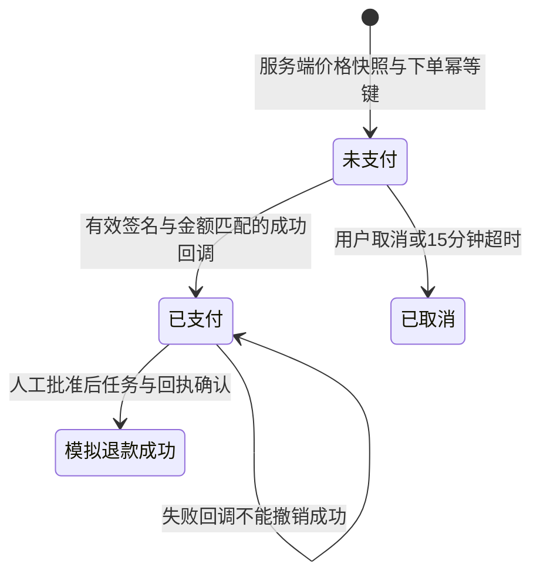
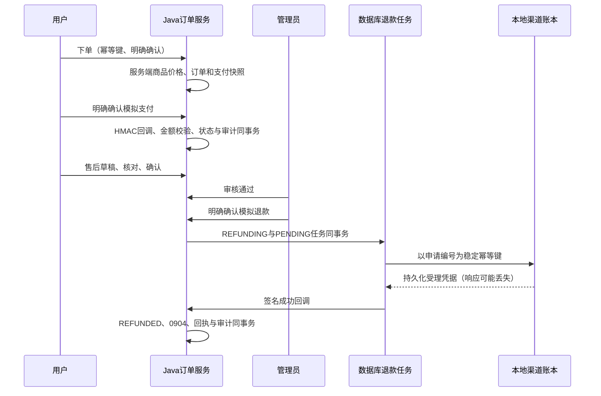

# 本地订单、支付与退款

此演示渠道在 Java `local` 与 `vm` 开发 profile 注册，不连接支付公司，不扣款，也不授予付费播放权益。商品“听见本地交易演示套餐”与 LOCAL-TEST 订单号均在页面明确标记。本地数据被运营统计排除。

## 状态与事务





下单幂等键按认证用户唯一。当前只有一个演示商品，创建交易会锁商品行以稳定价格并串行化重复下单；这是便于本地验证的实现，不能当作高并发商品库存方案。支付、取消和售后转换先锁订单行，再锁有关申请或交易行，所有成功事件与业务状态在同一事务写入。

退款任务是数据库 outbox：PENDING → PROCESSING → SUCCEEDED，领取增加尝试次数并设置 30 秒租约。工作进程在业务事务之外调用本地渠道；渠道账本单独提交，同一退款编号只生成一份凭据。响应丢失后，重试查询并复用该凭据，不再生成第二笔退款。失败退回 PENDING，等待 4、8、16、32 秒；最多尝试 5 次后标为 FAILED，售后显示 REFUND_FAILED，管理员可以明确确认重新发起。进程中断后，过期 PROCESSING 租约可被重新领取。

APPROVED 表示审核通过，REFUNDING 表示本地模拟处理中，REFUNDED 表示模拟完成。非本地模拟渠道订单只能继续审核，不能使用此退款渠道。真实支付还需要商户身份、证书与密钥治理、支付公司幂等约定、主动对账、迟到付款补偿、部分退款规则、风控与生产运维。

## HTTP 接口

前端统一访问 29183；Java 原始接口与 OpenAPI 见 `http://127.0.0.1:19204/v3/api-docs`。

| 方法与路径 | 认证 | 行为 |
| --- | --- | --- |
| GET `/api/business/local/products` | 无 | 本地商品与服务端价格 |
| POST `/api/business/local/checkout` | 听友 token | 创建或复用订单 |
| GET `/api/business/local/orders/{id}` | 本人 token | 支付状态、截止时间、退款尝试 |
| POST `/api/business/local/orders/{id}/simulate` | 本人 token | 明确确认成功或失败模拟 |
| POST `/api/business/local/orders/{id}/cancel` | 本人 token | 取消未支付订单 |
| GET `/api/business/local/orders/{id}/events` | 本人 token | 交易事件 |
| GET `/api/admin/refunds` | admin-token 与 payments:manage | 最近50条任务 |
| POST `/api/admin/refunds/{requestId}` | admin-token 与 payments:manage | 发起或重试本地模拟退款 |

下单示例：
```json
{"product":"listening-demo","idempotencyKey":"keep-this-key-for-retries","confirmed":true}
```
模拟支付：
```json
{"outcome":"SUCCESS","confirmed":true}
```
退款场景为 SUCCESS、FAIL_ONCE、TIMEOUT_ONCE、ALWAYS_FAIL：
```json
{"scenario":"TIMEOUT_ONCE","confirmed":true}
```

Java 回调 `/api/order/local/callback` 不通过前端代理开放。它需要 `x-payment-signature`，按下面六个字段的字符串值用换行连接，计算 HMAC-SHA256 十六进制摘要：kind、targetId、receiptId、amount、outcome、timestamp。金额固定两位小数，时间戳偏差不超过 300 秒；签名密钥位于被忽略的 `.runtime/payment-callback-key`，由启动脚本只传给本项目进程，不回显。退款回调还必须匹配本地渠道真实持久化的凭据。

401 为未认证或签名无效，403 为无管理权限，404 为不存在或不属于本人，409 为状态、金额或编号冲突，422 为字段错误或未明确确认。支付回调遇到已取消或过期订单返回其 CLOSED 状态，不会复活订单。
