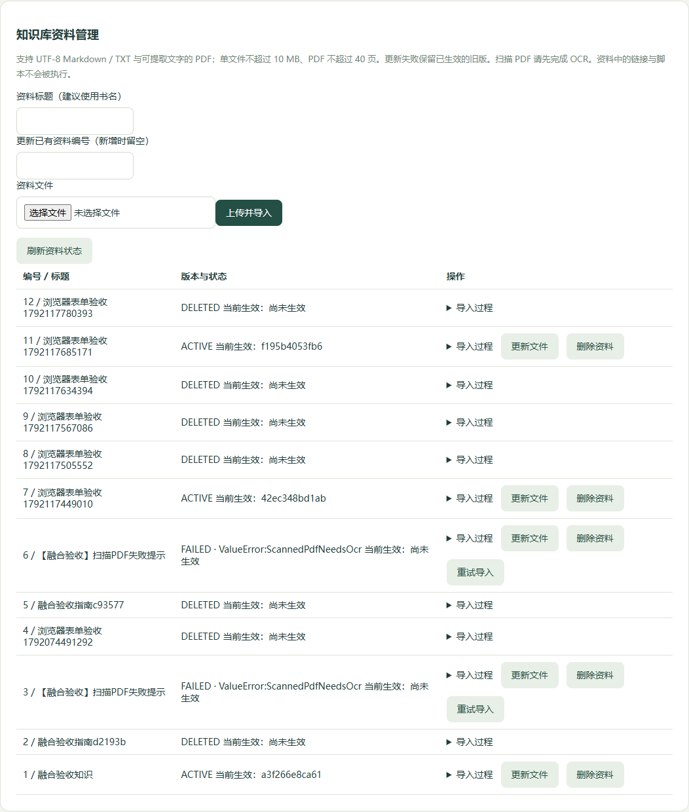

# 融合验收记录

验收环境：Windows 本机运行六个应用与 Rabbit 工作进程，虚拟机 `192.168.6.100` 运行中间件。记录范围为 2026-10-15 至 2026-10-16，本页仅列本版本实际运行结果。真实支付、云点播和数字人按维护者安排后续配置。

最终收尾检查：六个应用入口均返回 HTTP 200，Rabbit 工作进程心跳正常；失败浏览器测试遗留的两份临时资料已从有效语料删除，原件和审计保留。

## 结果与证明范围

| 检查 | 结果 | 证明范围 |
| --- | --- | --- |
| Python 单测 | 133 项通过 | 模型配置、请求治理、图路由、槽位与确认、知识导入、召回、SQL、资源边界 |
| Java 单测 | 42 项通过 | 售后16、支付13、权限5、用户2、Redis命名空间2、Mongo集合2、内容错误响应2 |
| H5 生产构建 | 通过 | 当前页面与助手组件；修复原有表单常量赋值构建警告 |
| 前两阶段业务 | 34 项通过 | 真实 RBAC、审核并发、分页、MP3 Range、账号与进度隔离 |
| 对话及向量模型 | 通过 | JSON、工具调用、1024维匹配；助手/知识/只读问数真实入口 |
| 固定 Top-5 召回 | 16/16 | 小样本，报告时121个片段（含当时的上传验收资料）；不是全场景准确率 |
| 固定 Agent 契约 | 20/20 | 工具路由、引用、多轮、只读问数与权限拒绝 |
| 模拟支付退款 | 30 项通过 | 并发幂等、伪造/过期回调、金额校验、五次重试、实际重启恢复、唯一渠道回执 |
| 融合专项 | 14 项通过 | 售后检查点实际重启恢复、越权与确认边界、资料上传/更新/删除、真实引用、SSE、问数三路召回、扫描PDF失败与三次尝试后的死信 |
| Mongo 进度 | 6 项通过 | 20次并发保存只保留一条、账号隔离、稳定ID、唯一索引、点查实际使用复合索引；最近记录查询另用显式 hint 验证索引，不宣称压测结论 |
| 搜索异步链路 | 通过 | 内容同事务 Outbox → Rabbit 确认投递与 ACK → ES 投影；同请求幂等、冲突拒绝、搜索建议及公开查询 |
| 浏览器操作 | 通过，0个页面脚本错误 | Edge 桌面/手机视口；管理刷新、知识表单上传删除、小窗/全屏、联网开关、登录、售后选订单/原因/刷新恢复/暂停继续/明确确认 |
| MCP 联网 | 通过 | 实际调用 WebSearch MCP 返回5个结果；测试调用独立于浏览器开关，不代表读取了网页全文 |
| 中间件与隔离 | 通过 | MySQL应用/只读权限、Redis越界命令拒绝、Rabbit发布确认及ACK、Nacos项目配置、ES连接；17个其他项目容器与重启后检查点一致 |

以上条目有重叠，不能相加宣传为独立用例总数。模型评测使用固定问题，结果受模型、额度与网络影响。知识语料会随上传、更新与删除变化，121是那次评测的快照值。

## 证据位置与复现

脱敏清单 [fusion-20261016.json](acceptance/fusion-20261016.json) 保存每份报告的本地位置、修改时间与 SHA-256。原始运行报告留在被忽略的 `.runtime`，不随源码公开。该清单用于对应当前工作目录的证据，不是第三方签名或远程 CI 运行证明。

复现命令见 [部署与验收](部署与验收.md)。`VerifyAll.ps1 -Live` 覆盖单测、基础健康、真实模型/召回/Agent和模拟交易重启；`VerifyFusion.py`、`VerifySearchSync.py`、`VerifyMongoProgress.py` 与 `VerifyBrowser.cjs` 覆盖本轮新增的融合路径。

2026-10-15 的 Agent 报告曾把 date 固定写成旧日期；本清单按报告文件的实际生成时间记录，原报告未回填伪造日期，脚本已改为运行时生成带时区时间。

## 隔离观察

保留最初的其他项目容器基线。期间观察到 VM 在 2026-10-15 22:23:58 外部重启；重启前后 Kibana 从 exited 变为 running，容器 ID 未变。本轮没有为了匹配旧基线停止 Kibana，也未重配置其他项目容器。

重启后只恢复了本项目 Redis ACL，没有启动共享 Redis 容器或修改其全局持久化配置。最终对比的是重启后的检查点：17个其他项目容器的 ID、镜像和状态一致。不能据此宣称整个历史期间外部环境完全没变化。

## 当前演示界面

手机布局与任务卡片也已实际验证，见 [手机截图](images/assistant-mobile.png)。截图账号、订单和资料均为验收数据。

## 尚未作为完成能力的范围

- 真实微信支付退款、付费播放权益、腾讯云点播、数字人：外部账号、凭据和真实渠道验收后续准备。
- 扫描PDF OCR、图片理解、原工程任意 YAML 执行引擎、全部历史微服务与直播、微信/App 真机：未复现为本轮验收能力。
- 跨主机高可用、生产鉴权与监控、分布式限流、吞吐压测：未验证。ES等共享组件仍存在应用隔离与基础设施强隔离的区别。
- 新VM镜像准备、历史对象/向量自动回收、长期备份恢复演练：部署限制与维护项见部署文档。

适合将此版本作为能实际演示和解释的实习主项目；简历贡献与来源需如实说明，参考 [面试提纲](求职项目提纲.md) 与 [能力映射](融合设计与能力映射.md)。
